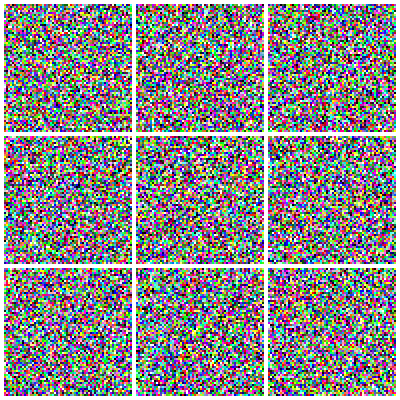

# score-based-diffusion

[](https://github.com/bravoivanagustin/score-based-diffusion/actions/workflows/ci.yml)
[](pyproject.toml)
[](LICENSE)

Score-based diffusion models built from scratch in PyTorch, following the stochastic differential equation formulation of [Song et al. (2021)](https://arxiv.org/abs/2011.13456). The project starts with 2D toy distributions, where the true score is known in closed form, and scales up to a U-Net that generates 64×64 cat faces.

<p align="center">
  
  <br>
  <em>Reverse-time integration from pure noise (t = T) to samples (t = 0).</em>
</p>

## Features

- **Forward SDEs:** VP, VE and sub-VP, each with its closed-form perturbation kernel and score target.
- **Reverse-time samplers:** Euler–Maruyama, the probability-flow ODE, Heun (2nd-order ODE) and predictor–corrector with Langevin steps. Uniform and log-SNR time grids.
- **Models:** a residual MLP for low-dimensional data and a U-Net with self-attention for images. Both support a score or an ε (noise-prediction) parametrization.
- **Training:** denoising score matching with log-uniform time sampling plus importance weights, EMA of the weights, mixed precision, held-out validation loss, and exact resume from checkpoints.
- **Analytic oracle:** for Gaussian mixtures, the exact marginal score at every t. Learned scores and samplers can be checked against the ground truth instead of eyeballing samples.

## Does the model memorize?

On a finite dataset, the minimizer of the denoising score matching objective has a closed form: the marginal of the VP-SDE is an exact Gaussian mixture centered on the training images, and Tweedie's formula gives its score. A network that reached the true optimum would only ever reproduce the training set.

[`notebooks/09_memorizacion.ipynb`](notebooks/09_memorizacion.ipynb) measures how close the cat U-Net gets to that empirical score over training:

- The validation loss reaches its minimum mid-run and rises afterwards. The rise is concentrated in the low and mid noise levels.
- The distance to the training-set empirical score keeps decreasing throughout training, a direct measurement of memorization. The distance to the held-out empirical score bottoms out at the same point as the validation loss.
- Despite this, samples from the overfit checkpoint are not visibly worse.
- Nearest-neighbour distances (correlation-based, flip-aware) are compared against a held-out → train null. Later checkpoints shift toward the training set, but the shift has to be read relative to that null: on a single-class dataset of aligned faces, two distinct real cats are already close.

## Installation

Requires Python ≥ 3.10 and [uv](https://docs.astral.sh/uv/).

```bash
git clone https://github.com/bravoivanagustin/score-based-diffusion.git && cd score-based-diffusion
uv sync                      # library, scripts and tests
uv sync --group analysis     # + Jupyter and LPIPS, for the notebooks
```

On Linux, PyTorch is installed from the CUDA 12.6 index. On other platforms, it comes from PyPI.

## Quickstart

Each run is defined by a YAML file under `config/`. All commands run from the repo root.

**2D toy (CPU, a few minutes):**

```bash
uv run python scripts/train.py --config config/toy/vp_mixture.yaml
uv run python scripts/sample.py models/toy/vp_mixture.pt --sampler pf_ode --out samples.npz
```

**Cats (GPU):**

The cat model is trained on [Cats faces 64x64 (For generative models)](https://www.kaggle.com/datasets/spandan2/cats-faces-64x64-for-generative-models) by Spandan Ghosh, about 9.3k aligned cat faces. Download it from Kaggle and extract it into `data/cats-v1/`. The dataset is not redistributed here, and its license is not specified on Kaggle.

```bash
# One-time: split the image folder into train/ and val/
uv run python scripts/split_dataset.py --src data/cats-v1 --out data/cats-v1-split --val-frac 0.05 --seed 0

uv run python scripts/train.py --config config/cats/cats_vp.yaml
uv run python scripts/trajectory_gif.py models/cats/cats_vp.pt --sampler heun \
    --n-steps 250 --time-grid logsnr --n-samples 9 --device cuda --out-dir outputs/gif
```

Available samplers: `euler`, `pf_ode`, `heun`, `pc`. Available time grids: `uniform`, `logsnr`. Run `--help` on any script to see every option.

## Project layout

```
src/diffusion/
  sde/              forward processes (VP, VE, sub-VP) and noise schedules
  models/           score networks (MLP, U-Net) and parametrizations
  samplers/         reverse-time SDE/ODE integrators and time grids
  training/         DSM loss, training loop, EMA, validation, resume
  data_generation/  2D toy distributions and image-folder datasets
  analytic/         exact scores for Gaussian mixtures
scripts/            command-line entry points (train, sample, GIF, dataset tools)
config/             experiment configs: toy/, cats/, test/
notebooks/          walkthrough from 2D data to images (00–09); audit/ holds sanity checks
tests/              pytest suite (runs on CPU)
```

## Notebooks

| Notebook | Topic |
|---|---|
| `00`–`02` | 2D toy data: forward process, training, sampling |
| `03`–`05` | Image pipeline: data loading, forward noising, reconstruction |
| `06`–`08` | Training the U-Net on cats, sampling, comparing checkpoints |
| `09` | Memorization: nearest training neighbours of generated samples |
| `audit/` | Marginals vs. theory, score vs. ε parametrization, last-step noise, error by t |

## Tests

```bash
uv run pytest                       # test suite (CPU is enough)
uv run ruff check . && uv run ruff format --check .   # lint + formatting
```

## References

- Y. Song, J. Sohl-Dickstein, D. P. Kingma, A. Kumar, S. Ermon, B. Poole. [Score-Based Generative Modeling through Stochastic Differential Equations](https://arxiv.org/abs/2011.13456). ICLR 2021.
- J. Ho, A. Jain, P. Abbeel. [Denoising Diffusion Probabilistic Models](https://arxiv.org/abs/2006.11239). NeurIPS 2020.
- T. Karras, M. Aittala, T. Aila, S. Laine. [Elucidating the Design Space of Diffusion-Based Generative Models](https://arxiv.org/abs/2206.00364). NeurIPS 2022.

## License

[MIT](LICENSE)
